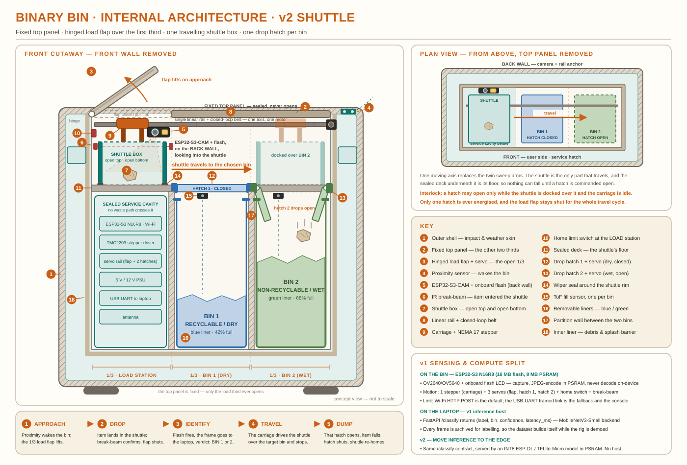

# Binary Bin

**A closed-lid smart bin that decides whether what you just threw away is
recyclable, and puts it in the right compartment without anyone sorting
anything.**

Team **nullVoid** · Buildathon 2026 · IEEE Computer Society, MIT Bengaluru ·
Smart City & Infrastructure



---

## The problem

Mixed waste goes into one bin, so recyclables get contaminated and the dry
fraction loses its value. India generates about **1.85 lakh tonnes of solid
waste a day** (CPCB 2023–24); roughly **39,600 t/day** still goes to landfill.
Only an estimated **30–35%** is scientifically segregated. Colour-coded bins
exist; compliance does not. And under the **Solid Waste Management Rules,
2026** (in force 1 April 2026) source segregation is no longer optional for
bulk generators.

Asking people to sort correctly has been tried. Binary Bin sorts for them, at
the moment of disposal, where the information is still intact.

## How it works

```
APPROACH  ->  DROP  ->  IDENTIFY  ->  TRAVEL  ->  DUMP
```

1. You walk up. A proximity sensor wakes the bin and the load flap lifts.
2. You drop the item. It lands in a **shuttle box** parked under the flap. An
   IR break-beam confirms it went in; the flap shuts.
3. The onboard flash fires, the camera takes one frame, and a classifier
   answers **bin 1 (recyclable / dry)** or **bin 2 (non-recyclable / wet)**.
4. The shuttle travels along a single rail to that bin.
5. That bin's hatch opens, the item falls, the hatch shuts, the shuttle
   returns home.

Total: roughly five seconds, hands-off, with the lid closed the whole time
except for the moment you are using it.

## The mechanism, in one paragraph

The top face is split into **thirds**. Only the **first third opens** — the
other two thirds are a sealed fixed panel. Under that opening sits a shuttle
box that is **open at the top and open at the bottom**: it has no floor of its
own, and the sealed deck it slides along is its floor. Each of the two bins
has one servo-driven **hatch** in that deck. Waste can therefore only fall when
a hatch is commanded open, and a hatch is only ever over a bin.

This replaces the twin sweep arms from the original pitch. Two independent
arms is two degrees of freedom, two alignments to hold, and a stranded item
whenever one stalls. One linear axis can be homed against one switch, and its
position checked against that switch before anything is allowed to drop.
See **[docs/MECHANISM.md](docs/MECHANISM.md)** for the full comparison and the
interlock list.

## v1: where the thinking happens

This is an **edge-AI** project, and v1 deliberately does not run the model on
the edge yet.

```
   ESP32-S3-CAM (N16R8)                        Laptop
   ---------------------                       ------
   camera + flash                              MobileNetV3-Small
   motion + interlocks   --- Wi-Fi / UART --->  /classify
   state machine         <--- bin: 1 | 2 ----   frame archive
```

The point is the **seam**. Everything the firmware asks of the outside world
is one function:

```cpp
Verdict classify(const uint8_t* jpeg, size_t len, uint32_t seq);
```

Two implementations answer it today (Wi-Fi HTTP, framed USB-UART). A third
will in v2: the same call, served by an INT8 model running in the S3's own
PSRAM. When that lands, the state machine, the interlocks, the camera code and
the verdict format all stay exactly as they are — the network simply stops
being in the loop. Drawing that line now is what makes v2 a swap instead of a
rewrite.

Meanwhile the laptop stage earns its keep: **every frame the bin has ever
seen is archived, named by its verdict.** Demoing the rig builds the training
set for the model that will replace the laptop.

## Repository layout

```
binary_bin_cutaway.svg          the architecture drawing above
firmware/binary-bin-s3cam/      PlatformIO project for the ESP32-S3
  include/board_pins.h            camera + actuator pin maps, per board
  include/config.h                every tunable, in one place
  src/camera_cfg.cpp              sensor bring-up, flash, capture
  src/link_wifi.cpp               transport A: HTTP POST
  src/link_uart.cpp               transport B: framed binary over USB
  src/motion.cpp                  axis, servos, homing, interlocks
  src/statemachine.cpp            the five-step cycle
  src/probe.cpp                   "which camera board is this?"
host/                           the v1 inference host
  serve_wifi.py                   FastAPI /classify + /telemetry
  serve_uart.py                   same classifier over pyserial
  dashboard.py                    bench viewfinder + scoring, in a browser
  showcase.py                     the same rig, dressed for the demo table
  static/fonts/                   IBM Plex, self-hosted (OFL 1.1)
  binarybin/bench.py              the live session both dashboards drive
  binarybin/classifier.py         three backends behind one interface
  binarybin/labels.py             ImageNet -> recyclable/non-recyclable
  binarybin/protocol.py           host half of the UART framing
  tools/train_finetune.py         fine-tune on your own captures
  tools/send_test_image.py        exercise the host with no hardware
data/captures/                  every frame the rig has seen
docs/                           mechanism, hardware, protocol, roadmap
```

## Getting started

### 1. Host

```bash
cd host
python -m venv .venv && source .venv/bin/activate
pip install -r requirements.txt
python serve_wifi.py
```

It picks a backend automatically: a fine-tuned checkpoint if you have one,
otherwise ImageNet MobileNetV3, otherwise a dependency-free heuristic. Check
it with no hardware attached:

```bash
curl -s localhost:8000/health
python tools/send_test_image.py some_photo.jpg
```

### 2. Find your board's camera pin map

"ESP32-S3-CAM" covers at least three different pin maps. Do not guess:

```bash
cd firmware/binary-bin-s3cam
pio run -e s3cam_probe -t upload && pio device monitor
# no PlatformIO? same thing through arduino-cli:
./tools/acli.sh flash probe && ./tools/acli.sh monitor
```

It tries each known map, reports which one works and the sensor it found,
then blinks every flash-LED candidate. Set `BB_BOARD_PROFILE` and
`BB_PIN_FLASH_LED` from what you see, once.

On the board we have, this came back **profile 1, sensor OV3660** — recorded
along with the rest of the measured hardware in
[docs/HARDWARE.md](docs/HARDWARE.md). Note that board talks through a **CH343
bridge**, so `ARDUINO_USB_CDC_ON_BOOT` must be `0` and the console is at
**921600**, not 115200.

### 3. Firmware

```bash
cp include/secrets.h.example include/secrets.h   # SSID, password, laptop IP
pio run -e s3cam -t upload                       # Wi-Fi link
# or
pio run -e s3cam_uart -t upload                  # USB-UART link
pio device monitor
```

For the UART link, run `python serve_uart.py` on the laptop instead of
`serve_wifi.py`. The Wi-Fi build falls back to UART by itself if it cannot
associate — which, on venue Wi-Fi, it eventually will not.

### 4. Before you power the motors

`kDryRun` in `include/config.h` is currently **`true`**, because nothing is
wired to the board yet. The whole state machine runs, logs every transition
and every verdict, and never energises a driver. Walk the cycle end to end on
the bench first; then set the real geometry from `docs/MECHANISM.md` and turn
it off.

With no presence sensor or break-beam attached, a bare `g` on the console
starts one cycle. For a hands-off demo loop:

```bash
python serve_uart.py --trigger 8     # sends that 'g' every 8 s
python tools/contact_sheet.py        # grid of captures + the verdict each got
```

### 5. Seeing what the camera sees

```bash
cd host && python dashboard.py        # http://127.0.0.1:8080
```

A live QQVGA viewfinder in the browser, so you can aim the lens instead of
guessing, with the labelling buttons next to the picture. The feed runs over
the same serial line as everything else and only while the machine is idle —
a classification frame is SVGA and the sensor cannot be both at once.

**Numpad 4** scores the item as recyclable (bin 1) and **numpad 6** as
non-recyclable (bin 2) — left key, left bin — so both hands stay on the
objects. Each capture answers with a popup large enough to read from the
bench: `OK — bin 1` in teal, `MISS — went to bin 2` in red, with what you
said and what the model said underneath.

This is the working screen — the one with the buttons and the key hints on
them. Section 6 is the same rig dressed for an audience.

Only one process can hold the serial port, so the dashboard *replaces*
`serve_uart.py` and `tools/bench_test.py` while it runs. It scores and saves
to the same place. It binds to localhost by default; the page can move the
mechanism, so only pass `--host 0.0.0.0` on a network you trust.

### 6. The screen for the demo table

```bash
cd host && python showcase.py         # http://127.0.0.1:8081
```

The same rig and the same classifier as section 5, dressed to be read from
three metres away: live feed, one enormous verdict card per item, and the
numbers a judge asks for — items sorted, agreement with ground truth,
inference time. The look is borrowed from BhuKavach, a sibling project: a
drafting sheet rather than a dashboard. Fonts are self-hosted, so it survives
the hall Wi-Fi being gone.

Nothing on screen announces the controls — the demo should look like a
machine deciding, not a person at a console:

| key | does |
|---|---|
| `4` | this item is **recyclable** → capture, classify, score |
| `6` | this item is **non-recyclable** → capture, classify, score |
| `space` | classify without scoring, for something you can't label |
| `0` | clear the tally between groups of judges |
| `esc` | dismiss the verdict card early |

`4` and `6` tell the *scoreboard* what the object really was. The verdict on
screen is always the machine's own — the big word is read off the bin the
classifier picked — so when it gets one wrong the card says MISS instead of
quietly agreeing with the key you pressed. Judges ask, and a demo that can't
be wrong isn't worth showing.

Only one process can hold the serial port, so run this *or* `dashboard.py`.

### 7. Testing with real objects, from the terminal

`tools/bench_test.py` is the one to use. It asks what the object actually is
before it fires, so it can score the model instead of just showing you what it
guessed, and each frame lands in `data/dataset/<truth>/` — the layout
`train_finetune.py` wants. A test session *is* the dataset collection.

```bash
cd host && python tools/bench_test.py
```

## Training on your own bin

```bash
# sort the archived frames into two folders
data/dataset/recyclable/*.jpg
data/dataset/non_recyclable/*.jpg

cd host
python tools/train_finetune.py --data ../data/dataset --epochs 12
BB_CHECKPOINT=models/binbin.pt python serve_wifi.py
```

Photographs of *this* bin, under *this* LED, at *this* working distance beat
any amount of cleverness applied to ImageNet labels. A couple of hundred
images per class gets you to the 90% target; a couple of thousand makes it
trustworthy. That checkpoint is also the input to v2.

## Design decisions worth knowing

**Fail-safe is bin 2.** Low confidence, no reply from the host, or no camera
frame all route to non-recyclable. A dry item in the wet bin costs one item;
a wet item in the dry bin contaminates the whole recyclable load — which is
the problem this project exists to fix.

**Interlocks live in the mechanism, not the logic.** `motion.cpp` refuses to
move with a hatch open, refuses to open a hatch unless the shuttle is parked
over exactly that bin, and refuses if the measured position is more than 3 mm
off. A bug in the state machine produces a fault, never a mis-sort.

**Faults are sticky.** A bin that silently sorts wrong is worse than one that
stops and says so.

**The UART link is framed and CRC'd**, not line-delimited JSON. The same port
carries the boot-ROM banner, panic dumps, and JPEG bytes that will contain
newlines. The host can start reading mid-stream and resynchronise, and it
counts how often it had to.

**The verdict reports honest confidence.** The host does not round an
uncertain answer up to a decision; both ends apply the same floor, so the
routing is auditable from either side.

## Status

| | |
|---|---|
| Mechanism redesign (shuttle replaces twin arms) | done |
| Camera stack on the ESP32-S3 | done, **running on real hardware** |
| Both transports | done; UART proven on hardware, Wi-Fi compiles only |
| Motion + interlocks + state machine | done, **dry-run only — nothing wired yet** |
| Host inference + dataset capture | done, **proven end to end** |
| Fine-tuning pipeline | done |
| Per-bin fill sensing | v1.5 |
| **Inference on the edge** | **v2 — see [docs/ROADMAP.md](docs/ROADMAP.md)** |

Proven on the bench on 2026-11-03: camera init, SVGA JPEG capture, UART
framing, host inference, verdict return, telemetry and the capture archive —
a full cycle, repeatedly, with real frames. Not yet proven: anything that
moves. See [docs/HARDWARE.md](docs/HARDWARE.md#bring-up-state).

## Team

| | | |
|---|---|---|
| **Swayam Panda** | captain | electronics & firmware — controller, sensors, interlock logic, integration |
| **Arnab Ranjan Sikdar** | | mechanical & CAD — chamber, shuttle and hatch mechanism, fabrication |
| **Atharv Somani** | | AI & app — classifier, fill dashboard, data collection |

## References

* CPCB 2023–24 waste figures (1.85 lakh t/day generated, 1.14 lakh t/day
  processed, 39,629 t/day landfilled), as reported by Vision IAS and Civilsdaily
* MoEFCC, **Solid Waste Management Rules, 2026** (in force 1 April 2026)
* PMF IAS summary of the SWM Rules 2026 — 30–35% scientific segregation estimate
* Thanks to IEEE Computer Society MIT BLR Chapter, IEEE CIS MIT Bengaluru and
  MIT Bengaluru for hosting Buildathon 2026
